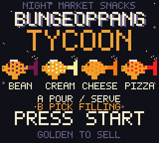

# Retro Game Creator

**English** · [한국어](docs/README.ko.md) · [日本語](docs/README.ja.md) · [简体中文](docs/README.zh.md) · [Português](docs/README.pt.md) · [Français](docs/README.fr.md) · [العربية](docs/README.ar.md) · [हिन्दी](docs/README.hi.md)

**Tell an AI coding agent to make a game and you get a real Game Boy Color ROM (`.gbc`).**

<p align="center">
  <a href="LICENSE"></a>
  
  
  
  
</p>

<p align="center">
  
</p>
<p align="center">
  <em>Bungeoppang Tycoon Plus — built with this kit, captured from the released ROM.
  <a href="https://github.com/dong3789/bungeoppang-tycoon-plus-gbc">repo</a> ·
  <a href="https://github.com/dong3789/bungeoppang-tycoon-plus-gbc/releases/tag/v1.0">play it</a></em>
</p>

One skill document (`SKILL.md`), three automation tools, a starter template — and **two complete games that shipped**, both playable on the handheld in your bag right now.

It takes the workflow OpenAI × ModRetro's [Chromatic](https://openai.com/en-US/supply/co-lab/chromatic/) (a Game Boy hardware-compatible handheld) showed off — the AI writes C, GBDK burns a ROM, and the emulator's frames get checked by eye — and makes it run on hardware you already own instead of a $200 device.

`R36S · Miyoo Mini · Anbernic · iPhone (Delta) · desktop and web emulators · real hardware` — one `.gbc` file runs on all of them.

---

## Showcase — made with this kit

Two games, both released as `.gbc`. They came out of the same loop this repo enforces: write C against `SKILL.md`, compile with GBDK-2020, replay the ROM headlessly with `tools/playtest.py`, look at the frames, fix, repeat. Every animation and strip below was captured from the **released ROM**, not drawn as a mockup.

### 1. Bungeoppang Tycoon Plus

> A night-market fish-bread stall, 90 seconds on the clock.

[Repository](https://github.com/dong3789/bungeoppang-tycoon-plus-gbc) · [Release v1.0 · `bungeoppang-plus.gbc` (32 KiB)](https://github.com/dong3789/bungeoppang-tycoon-plus-gbc/releases/tag/v1.0)

| | |
| --- | --- |
| Genre | 90-second score-attack cooking sim |
| The loop | Four griddle moulds, four fillings — BEAN / CREAM / CHEESE / PIZZA. Pour batter, wait for golden brown, sell the filling the customer actually ordered |
| Controls | D-pad: pick a mould · **A**: pour / serve / scrape a burnt one · **B**: change filling (hold to repeat) · **SELECT**: reverse · **START**: start, restart |
| Depth | Customers walk in with a filling and a patience bar, combos build with every correct sale, and the shift ends in an S/A/B/C rank on your takings (S = 6000 gold) |
| Hardware budget | 246 of the 256 background tile indices, 28 of the 40 OAM sprites. The four fillings share one set of tiles and differ by palette only — switching costs no VRAM |
| ROM | CGB-only (`0xC0`), 32 KiB, MBC5+RAM+battery (`0x1B`) |

<p align="center"></p>

The strip is five frames pulled from the released ROM: the title card, a customer asking for CREAM, batter poured into three moulds, golden, and the sale (`GOLD 100 · COMBO 1`).

### 2. Ramen Time

> Three rounds, five steps, one button — and a cursor that is faster than you.

[Repository](https://github.com/dong3789/ramen-time-gbc) · [Release v1.0 · `ramen-time.gbc` (32 KiB)](https://github.com/dong3789/ramen-time-gbc/releases/tag/v1.0)

| | |
| --- | --- |
| Genre | Timing / rhythm cooking game |
| The loop | **BOIL → NOODLES → SOUP → TOPPING → STOP**, five times per round, three rounds. Hit the moving cursor inside the green window |
| Controls | **A**: hit the timing (and drop the egg on TOPPING) · **B**: add spring onion · **START**: start / play again · **SELECT**: back to the title |
| Depth | Perfect is the middle 16 px of a 112 px gauge (100 pts), GOOD is 60, a miss is 0; the cursor is 1 px / 2 frames in round 1, 1 px / frame in round 2, 2 px / frame in round 3; stop too early and the noodles are HARD, too late and they are SOGGY. 1260 is a perfect run |
| Hardware budget | 215 background + 3 sprite tiles of the 384 VRAM slots, 3 of the 40 OAM sprites — the pot changes by swapping one tile row per phase |
| ROM | CGB-enhanced (`0x80`), 32 KiB, MBC5+RAM+battery (`0x1B`) |

<p align="center"></p>

<p align="center"></p>

The results card at the right is a real 15-phase run driven by reading the cursor sprite out of the emulator's memory: rating **S**, score **1260**, *PERFECT NOODLES*.

**What the two games have in common is the point:** a full input→score→rank loop, palette-only art variation, and a playtest strip a human can actually read. That is the bar this kit holds you to.

---

## Quick start (30 seconds)

```bash
git clone https://github.com/dong3789/retro-game-creator.git
cd retro-game-creator

./tools/check_env.sh                 # GBDK, python, pillow, pyboy
./templates/minimal-gbc/build.sh     # build the starter ROM → build/tile-hop.gbc

python3 tools/playtest.py --rom templates/minimal-gbc/build/tile-hop.gbc \
  --script "wait:8,press:start:4,wait:16,hold:right:36,snap:score" \
  --out build/strip.png
```

Open `build/strip.png`. That is the game.

Get GBDK-2020 from the [releases page](https://github.com/gbdk-2020/gbdk-2020/releases), unpack it anywhere, and
`export GBDKDIR=/path/to/gbdk/` (**keep the trailing `/`**). `build.sh` also looks in `/opt/gbdk`, `~/gbdk` and a few other places, and builds fine without `make`.

## Minimal starter template — TILE HOP

`templates/minimal-gbc/` is the base you copy. It is not an empty shell: it goes from title screen to play, score and clear, so every piece you need to keep (vsync loop, joypad edge detection, tile map, sprite, sound, HUD) is already wired.

| | |
| --- | --- |
| Controls | D-pad to move, `START` to start, `SELECT` back to the title |
| Goal | Eat all 6 stars for `CLEAR!`, then the stars are re-dealt and the score resets (endless) |
| What's in it | 5 colour palettes, separate BG/OBJ palettes, tile collision, sprite animation, sound, HUD |
| Size | ROM 32 KiB · 182 of 384 VRAM tiles |

| Title | Play | Clear |
| --- | --- | --- |
|  |  |  |

The middle strip is frames `tools/playtest.py` captured while actually running the ROM —
title → start → walk right and grab a star (SCORE 00→01, STAR 6→5) → move → back to the title.
**"It renders on screen" is the bar, not "it compiled."**

## Run it anywhere

`.gbc` is a standard Game Boy Color ROM, so the same file runs everywhere below — including the two showcase games above.

| Device | How |
| --- | --- |
| **R36S (ArkOS)** | Copy into the GBC folder on the microSD's `EASYROMS` partition → Gambatte or SameBoy core (details below) |
| **Miyoo Mini (Onion), Anbernic RG35XX, …** | Same idea — drop it in the handheld's GBC ROM folder |
| **iPhone / iPad** | Open the `.gbc` in the Delta app |
| **PC / Mac** | SameBoy, mGBA |
| **Real hardware** | Game Boy Color + a flash cart |

### Putting it on an R36S

1. Put the microSD in your PC and open the **EASYROMS** partition (not `BOOT`).
2. Copy the `.gbc` into the GBC folder — usually `EASYROMS/roms/gbc/`, sometimes `EASYROMS/gbc/` depending on the image.
   Folder names are case-sensitive. If the game doesn't show up, the folder is wrong, not the ROM.
3. Launch it. Use the **Gambatte** core (default, fine) or **SameBoy** (most accurate).
4. Display: GBC is 160×144, exactly **10:9**, while the R36S panel is 640×480 (4:3).
   In `Settings → Video → Scaling`, set **Aspect Ratio: Core Provided** and **Integer Scale: ON → 480×432 (3×)**.
   Pixels land on a clean square grid. 4× (640×576) doesn't fit in 480 rows, so it falls back to 3× anyway.
   "Fill the screen" stretches 10:9 into 4:3, about 20% wider — not recommended for pixel art.

## What's in the repo

```
SKILL.md                  the agent-facing guide — hardware limits, GBDK API, build/playtest loop
AGENTS.md / CLAUDE.md     summary rules Codex and Claude Code read at the repo root
tools/
  png2gbc.py              PNG → 8×8 2bpp tiles + BGR555 palette C code (+ tile-grid preview)
  artfont.py              draw logos and text into a PNG with a 5×7 pixel font
  playtest.py             headless PyBoy run + key-input script + screenshot strip
  check_env.sh            check GBDK / python / pillow / pyboy
templates/minimal-gbc/    the starter game "TILE HOP" (title → play → score → clear)
docs/images/              screenshots and GIFs captured from real ROMs (both showcase games + TILE HOP)
docs/ci.md                the full CI workflow + how to register it once (not in the repo yet)
```

The two showcase games live in their own repositories —
[`bungeoppang-tycoon-plus-gbc`](https://github.com/dong3789/bungeoppang-tycoon-plus-gbc) and
[`ramen-time-gbc`](https://github.com/dong3789/ramen-time-gbc) — with their full source, build scripts and `docs/` screenshots.

## Hook it up to your agent

| Tool | How it gets read |
| --- | --- |
| **Claude Code** | Open the repo and it reads `CLAUDE.md`. Ask for something like "copy TILE HOP and turn it into a shooter" and it follows the rules in `SKILL.md`. |
| **Codex / other agents** | They read `AGENTS.md`. If yours reads neither, paste one line at the start of the chat telling it to read `SKILL.md`. |
| **Claude Skill format** | `SKILL.md` carries frontmatter (`name`, `description`), so it drops straight into a skills folder as-is. |

What the skill enforces: a 384-tile VRAM budget, 4 colours per tile, 8×8 alignment, 40 OAM entries with 10 per scanline,
a `vsync()` loop, CGB register guards, and **always look at the playtest strip after a build**.

## The loop (as written in the skill)

1. **One paragraph of design + one pass/fail line** — "walk right for 36 frames, eat a star, and the score goes 0→1"
2. **PNG art** → convert tiles and palettes with `tools/png2gbc.py`, check the preview by eye
3. **C code** — copy `templates/minimal-gbc/src/main.c` and change it
4. **Build** — `./build.sh` (lcc)
5. **Playtest** — run a key-input script → get a strip PNG
6. **Open the strip yourself** → fix and repeat
7. **Keep the evidence** — strips and screenshots in `docs/images/`, linked from the README

Both showcase games went through this loop until the strip was worth looking at. When the automation is worth more than a screenshot, read the game's own state at runtime instead of guessing: the Ramen Time GIF above was driven by reading the timing cursor out of the sprite attribute table and pressing `A` inside the perfect window, and the Bungeoppang GIF by sampling the customer's order from the framebuffer and picking that filling with `B`.

## Three tools

```bash
# 1) art: sprites are 3 colours + transparent, backgrounds 4 colours.
#    --dedup merges duplicate tiles, --palette pins the palette
python3 tools/png2gbc.py assets/player.png --mode sprite --name player -o src/gen/player
python3 tools/png2gbc.py assets/level.png  --mode bg --map --dedup --name level -o src/gen/level

# 2) text: draw logos and strings into a PNG with a 5×7 font (integer scale)
python3 tools/artfont.py "PRESS START" --scale 2 --color "#FFEBC2" --out press.png

# 3) playtest: wait / press / hold / release / snap
python3 tools/playtest.py --rom build/tile-hop.gbc \
  --script "wait:40,press:start:4,wait:20,snap:play,hold:right:40,release:right,snap:score" \
  --out build/strip.png
```

`playtest.py` also calls out the classic failures: "every frame is identical (= input isn't reaching the game)",
"two colours or fewer (= palette/display problem)", "blank frame". Treat a warning as a bug and fix it.

## Hardware cheat sheet (more in `SKILL.md`)

| Item | Value |
| --- | --- |
| Screen | 160×144 (20×18 tiles) |
| Tile | 8×8, 2bpp = 4 colours per tile, 16 bytes |
| VRAM | 384 tiles (8 KiB) — background and sprites share **the same space** |
| Palettes | 8 BG + 8 OBJ × 4 colours, BGR555 15-bit |
| Sprites | 40 OAM entries, **10 per scanline** |
| Frame | 59.7 fps, ~70,224 cycles |
| Sound | 4 channels (2 square, 1 wave, 1 noise) |

## CI

[`docs/ci.md`](docs/ci.md) holds the full workflow — an Ubuntu runner pulls GBDK-2020 4.5.0, builds
`templates/minimal-gbc`, checks the ROM header (size, title, cart type `0x1B`, CGB flag `0x80`), runs the
PyBoy playtest with `--strict`, and uploads the `.gbc` and the screenshot strip as artifacts.

> This repo does not have `.github/workflows/build-rom.yml` **registered yet.** The GitHub token used for the
> first push lacked the `workflows` permission, so GitHub rejected that file. Paste the file from `docs/ci.md`
> into the web UI once, and it runs on every push from then on.

## Credits

- Compiler: [GBDK-2020](https://github.com/gbdk-2020/gbdk-2020) (on top of SDCC)
- Emulator: [PyBoy](https://github.com/Baekalfen/PyBoy) — for headless review
- References: Pan Docs (Game Boy hardware), GBDK 2020 Docs
- Inspiration: OpenAI × ModRetro **Chromatic: Codex Edition**

MIT License — see [LICENSE](LICENSE). Build games, modify them, sell them.
Questions and bugs go to [Issues](https://github.com/dong3789/retro-game-creator/issues); games you made with this kit are always welcome.
