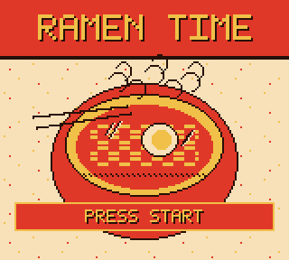

# Retro Game Creator

[English](../README.md) · [한국어](README.ko.md) · [日本語](README.ja.md) · [简体中文](README.zh.md) · [Português](README.pt.md) · [Français](README.fr.md) · **العربية** · [हिन्दी](README.hi.md)

**اطلب من وكيل برمجة ذكي لعبة، فتحصل على روم Game Boy Color حقيقي (`.gbc`).**

<p align="center">
  <a href="../LICENSE"></a>
  
  
  
  
</p>

<p align="center">
  
</p>
<p align="center">
  <em>Bungeoppang Tycoon Plus — صُنعت بهذه العدة، والصورة مأخوذة من الروم المنشور.
  <a href="https://github.com/dong3789/bungeoppang-tycoon-plus-gbc">المستودع</a> ·
  <a href="https://github.com/dong3789/bungeoppang-tycoon-plus-gbc/releases/tag/v1.0">العبها</a></em>
</p>

مستند مهارة واحد (`SKILL.md`)، وثلاث أدوات أتمتة، وقالب بداية — و**لعبتان كاملتان نُشرتا فعلاً**، وكلتاهما تعملان على الجهاز المحمول الموجود في حقيبتك الآن.

إنها طريقة [Chromatic](https://openai.com/en-US/supply/co-lab/chromatic/) من OpenAI × ModRetro (جهاز محمول متوافق مع Game Boy) — الذكاء الاصطناعي يكتب بلغة C، وGBDK يحرق الروم، وتُفحص إطارات المحاكي بالعين — لكنها تعمل على جهاز تملكه بالفعل بدل شراء جهاز بـ 200 دولار.

`R36S · Miyoo Mini · Anbernic · iPhone (Delta) · محاكيات سطح المكتب والويب · الجهاز الأصلي` — ملف `.gbc` واحد يعمل على الجميع.

---

## المعرض — ما صُنع بهذه العدة

لعبتان، كلتاهما منشورة بصيغة `.gbc`. خرجتا من الحلقة نفسها التي يفرضها هذا المستودع: كتابة C وفق `SKILL.md`، والبناء بـ GBDK-2020، وإعادة تشغيل الروم بلا شاشة عبر `tools/playtest.py`، والنظر إلى الإطارات، والإصلاح، والتكرار. كل الرسوم المتحركة والشرائط أدناه مأخوذة من **الروم المنشور**، لا من تصميم تخييلي.

### 1. Bungeoppang Tycoon Plus

> كشك كعك السمك في السوق الليلي، و90 ثانية على العدّاد.

[المستودع](https://github.com/dong3789/bungeoppang-tycoon-plus-gbc) · [الإصدار v1.0 · `bungeoppang-plus.gbc` (32 كيلوبايت)](https://github.com/dong3789/bungeoppang-tycoon-plus-gbc/releases/tag/v1.0)

| | |
| --- | --- |
| النوع | لعبة طبخ وسباق نقاط في 90 ثانية |
| الحلقة | أربعة قوالب على الشبكة وأربعة حشوات — BEAN / CREAM / CHEESE / PIZZA. اسكب العجين، وانتظر اللون الذهبي، ثم بِع الحشوة التي طلبها الزبون |
| التحكم | الأسهم: اختيار القالب · **A**: سكب / بيع / كشط المحروق · **B**: تغيير الحشوة (اضغط مطولاً للتكرار) · **SELECT**: عكس الاتجاه · **START**: البدء أو الإعادة |
| العمق | يصل الزبون بحشوة وشريط صبر، ويكبر الكومبو مع كل بيعة صحيحة، وينتهي الشوط بتقييم S/A/B/C على المبيعات (S = 6000 ذهبة) |
| ميزانية العتاد | 246 من 256 فهرس بلاطة خلفية، و28 من 40 كائن OAM. الحشوات الأربع تتشارك البلاطات نفسها وتختلف باللوحة اللونية فقط — التبديل لا يكلّف ذاكرة VRAM |
| الروم | خاص بـ CGB (`0xC0`)، 32 كيلوبايت، MBC5+RAM+بطارية (`0x1B`) |

<p align="center"></p>

الشريط خمس لقطات مسحوبة من الروم المنشور: شاشة العنوان، زبون يطلب CREAM، العجين في القالب الأول، اللون الذهبي، ثم البيع (`GOLD 100 · COMBO 1`).

### 2. RAMEN TIME

> ثلاث جولات، خمس خطوات، زر واحد — ومؤشر أسرع منك.

[المستودع](https://github.com/dong3789/ramen-time-gbc) · [الإصدار v1.0 · `ramen-time.gbc` (32 كيلوبايت)](https://github.com/dong3789/ramen-time-gbc/releases/tag/v1.0)

| | |
| --- | --- |
| النوع | لعبة طبخ قائمة على التوقيت والإيقاع |
| الحلقة | **BOIL → NOODLES → SOUP → TOPPING → STOP**، خمس مرات في الجولة، وثلاث جولات. اضغط عندما يكون المؤشر داخل النطاق الأخضر |
| التحكم | **A**: ضبط التوقيت (ووضع البيضة في TOPPING) · **B**: إضافة البصل الأخضر · **START**: البدء / جولة أخرى · **SELECT**: العودة إلى العنوان |
| العمق | نطاق PERFECT هو 16 بكسل في منتصف مقياس طوله 112 بكسل (100 نقطة)، وGOOD بـ60، والخطأ صفر؛ سرعة المؤشر: 1 بكسل كل إطارين في الجولة الأولى، و1 بكسل لكل إطار في الثانية، و2 بكسل لكل إطار في الثالثة؛ التوقف المبكر يجعل النودلز HARD والمتأخر SOGGY. الكمال 1260 نقطة |
| ميزانية العتاد | 215 بلاطة خلفية + 3 بلاطات كائنات من أصل 384 خانة VRAM، و3 من 40 كائن OAM — القدر يتغيّر بتبديل سطر بلاطات واحد لكل خطوة |
| الروم | يدعم CGB (`0x80`)، 32 كيلوبايت، MBC5+RAM+بطارية (`0x1B`) |

<p align="center"></p>

<p align="center"></p>

بطاقة النتيجة في أقصى اليمين جاءت من جولة حقيقية من 15 خطوة، قُدت فيها اللعبة بقراءة مؤشر التوقيت من ذاكرة المحاكي: التقييم **S**، والنقاط **1260**، و*PERFECT NOODLES*.

**القاسم المشترك بين اللعبتين هو المقصد:** حلقة كاملة من الإدخال إلى النقاط إلى التقييم، وتنويع بصري باللوحة اللونية فقط، وشريط اختبار لعب يستطيع إنسان أن يقرأه فعلاً. هذا هو المعيار الذي تطلبه هذه العدة.

---

## البدء في 30 ثانية

```bash
git clone https://github.com/dong3789/retro-game-creator.git
cd retro-game-creator

./tools/check_env.sh                 # GBDK وpython وpillow وpyboy
./templates/minimal-gbc/build.sh     # بناء الروم النموذجي → build/tile-hop.gbc

python3 tools/playtest.py --rom templates/minimal-gbc/build/tile-hop.gbc \
  --script "wait:8,press:start:4,wait:16,hold:right:36,snap:score" \
  --out build/strip.png
```

افتح `build/strip.png`. هذه هي اللعبة.

نزّل GBDK-2020 من [صفحة الإصدارات](https://github.com/gbdk-2020/gbdk-2020/releases)، وفكّ ضغطه في أي مكان، ثم
`export GBDKDIR=/path/to/gbdk/` (**أبقِ الشرطة المائلة `/` في النهاية**). يبحث `build.sh` أيضاً في `/opt/gbdk` و`~/gbdk` وأماكن أخرى، ويبني دون `make`.

## قالب البداية — TILE HOP

`templates/minimal-gbc/` هو القاعدة التي تنسخها. ليس هيكلاً فارغاً: يمتد من شاشة العنوان إلى اللعب فالنقاط فالإنهاء، لذا كل قطعة تحتاج إلى إبقائها (حلقة `vsync()`، وكشف حافة أزرار اليد، وخريطة البلاطات، والكائنات، والصوت، وشريط المعلومات) موصولة سلفاً.

| | |
| --- | --- |
| التحكم | الأسهم للحركة، `START` للبدء، `SELECT` للعودة إلى العنوان |
| الهدف | أكل النجوم الستة لـ`CLEAR!`، ثم تُوزَّع النجوم من جديد وتُصفَّر النقاط (بلا نهاية) |
| ما فيه | 5 لوحات ألوان، ولوحات BG/OBJ منفصلة، وتصادم بالبلاطات، ورسوم متحركة للكائنات، وصوت، وشريط معلومات |
| الحجم | الروم 32 كيلوبايت · 182 بلاطة من 384 في VRAM |

| العنوان | اللعب | الإنهاء |
| --- | --- | --- |
|  |  |  |

الشريط الأوسط إطارات التقطها `tools/playtest.py` أثناء تشغيل الروم فعلاً —
العنوان → البدء → المشي يميناً وأخذ نجمة (SCORE 00→01، STAR 6→5) → الحركة → العودة إلى العنوان.
**المعيار هو «يظهر على الشاشة»، لا «تم البناء».**

## شغّلها في أي مكان

`.gbc` روم قياسي لـGame Boy Color، لذا يعمل الملف نفسه في كل ما يلي — بما في ذلك لعبتا المعرض أعلاه.

| الجهاز | الطريقة |
| --- | --- |
| **R36S (ArkOS)** | انسخه إلى مجلد GBC في قسم `EASYROMS` ببطاقة microSD ← نواة Gambatte أو SameBoy (التفاصيل أدناه) |
| **Miyoo Mini (Onion) وAnbernic RG35XX وغيرها** | الفكرة نفسها — ضعه في مجلد رومات GBC بالجهاز |
| **iPhone / iPad** | افتح `.gbc` في تطبيق Delta |
| **PC / Mac** | SameBoy أو mGBA |
| **الجهاز الأصلي** | Game Boy Color مع خرطوشة فلاش |

### الوضع على R36S

1. ضع بطاقة microSD في الحاسوب وافتح قسم **EASYROMS** (لا `BOOT`).
2. انسخ `.gbc` إلى مجلد GBC — غالباً `EASYROMS/roms/gbc/`، وأحياناً `EASYROMS/gbc/` حسب الصورة.
   أسماء المجلدات حساسة لحالة الأحرف. إن لم تظهر اللعبة فالمشكلة في المجلد لا في الروم.
3. شغّلها. استخدم نواة **Gambatte** (الافتراضية، جيدة) أو **SameBoy** (الأكثر دقة).
4. العرض: شاشة GBC هي 160×144 أي **10:9** بالضبط، وشاشة R36S هي 640×480 (4:3).
   في `Settings → Video → Scaling` اختر **Aspect Ratio: Core Provided** و**Integer Scale: ON → 480×432 (3×)**.
   تستقر البكسلات على شبكة مربعة نظيفة. المقياس 4× (640×576) لا يتسع في 480 سطراً، فيعود إلى 3× على أي حال.
   خيار «ملء الشاشة» يمدّ 10:9 إلى 4:3 أي أوسع بنحو 20% — غير مستحسن لفن البكسل.

## ما في المستودع

```
SKILL.md                  دليل الوكيل — حدود العتاد، وواجهة GBDK، وحلقة البناء والاختبار
AGENTS.md / CLAUDE.md     قواعد موجزة يقرأها Codex وClaude Code في جذر المستودع
tools/
  png2gbc.py              PNG ← بلاطات 8×8 بصيغة 2bpp + كود C للوحة BGR555 (+ معاينة شبكة البلاطات)
  artfont.py              رسم الشعارات والنصوص في PNG بخط 5×7 بكسل
  playtest.py             تشغيل PyBoy بلا شاشة + سكربت مفاتيح + شريط لقطات
  check_env.sh            فحص GBDK وpython وpillow وpyboy
templates/minimal-gbc/    لعبة البداية "TILE HOP" (عنوان → لعب → نقاط → إنهاء)
docs/images/              لقطات وGIF من رومات حقيقية (لعبتا المعرض + TILE HOP)
docs/ci.md                ملف CI الكامل + طريقة تسجيله مرة واحدة (غير مسجَّل في المستودع بعد)
```

لعبتا المعرض تقيمان في مستودعين مستقلين —
[`bungeoppang-tycoon-plus-gbc`](https://github.com/dong3789/bungeoppang-tycoon-plus-gbc) و
[`ramen-time-gbc`](https://github.com/dong3789/ramen-time-gbc) — مع الكود الكامل وسكربتات البناء ولقطات `docs/`.

## اربط وكيلك

| الأداة | كيف يُقرأ |
| --- | --- |
| **Claude Code** | افتح المستودع فيقرأ `CLAUDE.md`. اطلب مثلاً «انسخ TILE HOP وحوّله إلى لعبة رماية» فيتبع قواعد `SKILL.md`. |
| **Codex وغيره** | يقرأون `AGENTS.md`. إن لم تكن أداتك تقرأ أياً منهما، ألصق سطراً في بداية المحادثة يطلب قراءة `SKILL.md`. |
| **صيغة Claude Skill** | يحمل `SKILL.md` ترويسة frontmatter (`name`، `description`)، لذا يدخل مجلد المهارات كما هو. |

ما تفرضه المهارة: ميزانية 384 بلاطة في VRAM، و4 ألوان للبلاطة، ومحاذاة 8×8، و40 مدخلاً في OAM بعشرة لكل سطر مسح،
وحلقة `vsync()`، وحماية سجلات CGB، و**النظر إلى شريط اختبار اللعب بعد كل بناء دائماً**.

## الحلقة (كما كُتبت في المهارة)

1. **فقرة تصميم + سطر نجاح/فشل** — «امشِ يميناً 36 إطاراً، كُل نجمة، فتنتقل النقاط من 0 إلى 1»
2. **فن PNG** ← تحويل البلاطات واللوحات بـ`tools/png2gbc.py`، وفحص المعاينة بالعين
3. **كود C** — انسخ `templates/minimal-gbc/src/main.c` وعدّله
4. **البناء** — `./build.sh` (lcc)
5. **اختبار اللعب** — شغّل سكربت المفاتيح ← تحصل على شريط PNG
6. **افتح الشريط بنفسك** ← أصلح وكرّر
7. **احتفظ بالدليل** — الشرائط واللقطات في `docs/images/` ومربوطة من README

لعبتا المعرض مرّتا بهذه الحلقة حتى صار الشريط جديراً بالنظر. وحين تكون الأتمتة أنفع من لقطة شاشة، اقرأ حالة اللعبة أثناء التشغيل بدل التخمين: الـGIF الخاص بـRAMEN TIME قُد بقراءة مؤشر التوقيت من جدول سمات الكائنات والضغط على `A` داخل النطاق المثالي، وذاك الخاص بـBungeoppang بأخذ طلب الزبون من إطار الشاشة واختيار الحشوة بـ`B`.

## ثلاث أدوات

```bash
# 1) الفن: الكائنات 3 ألوان + شفافية، والخلفيات 4 ألوان.
#    --dedup يدمج البلاطات المكررة، و--palette يثبّت اللوحة
python3 tools/png2gbc.py assets/player.png --mode sprite --name player -o src/gen/player
python3 tools/png2gbc.py assets/level.png  --mode bg --map --dedup --name level -o src/gen/level

# 2) النص: رسم الشعارات والنصوص في PNG بخط 5×7 (تكبير صحيح)
python3 tools/artfont.py "PRESS START" --scale 2 --color "#FFEBC2" --out press.png

# 3) اختبار اللعب: wait / press / hold / release / snap
python3 tools/playtest.py --rom build/tile-hop.gbc \
  --script "wait:40,press:start:4,wait:20,snap:play,hold:right:40,release:right,snap:score" \
  --out build/strip.png
```

ينبّه `playtest.py` أيضاً إلى الأعطال الكلاسيكية: «كل الإطارات متطابقة (= الإدخال لا يصل إلى اللعبة)»،
و«لونان أو أقل (= مشكلة في اللوحة أو العرض)»، و«إطار فارغ». اعتبر التحذير خطأً وأصلحه.

## ورقة مرجعية للعتاد (المزيد في `SKILL.md`)

| العنصر | القيمة |
| --- | --- |
| الشاشة | 160×144 (20×18 بلاطة) |
| البلاطة | 8×8، 2bpp = 4 ألوان للبلاطة، 16 بايت |
| VRAM | 384 بلاطة (8 كيلوبايت) — الخلفية والكائنات تتشارك **المساحة نفسها** |
| اللوحات | 8 للخلفية + 8 للكائنات × 4 ألوان، BGR555 بـ15 بت |
| الكائنات | 40 مدخلاً في OAM، **10 لكل سطر مسح** |
| الإطار | 59.7 إطاراً في الثانية، نحو 70,224 دورة |
| الصوت | 4 قنوات (موجتان مربعتان، وموجة، وضجيج) |

## CI

يحتوي [`docs/ci.md`](ci.md) ملف سير العمل الكامل — منفّذ Ubuntu يجلب GBDK-2020 4.5.0، ويبني
`templates/minimal-gbc`، ويفحص ترويسة الروم (الحجم، والعنوان، ونوع الخرطوشة `0x1B`، وعلم CGB `0x80`)، ويشغّل
اختبار PyBoy بـ`--strict`، ويرفع `.gbc` وشريط اللقطات كمنتجات.

> هذا المستودع **لا يملك** `.github/workflows/build-rom.yml` مسجَّلاً بعد. رمز GitHub المستخدم في الدفعة
> الأولى كان يفتقد إذن `workflows`، فرفض GitHub الملف. ألصق ملف `docs/ci.md` مرة واحدة في واجهة الويب،
> وسيعمل مع كل دفعة بعد ذلك.

## الشكر

- المترجم: [GBDK-2020](https://github.com/gbdk-2020/gbdk-2020) (فوق SDCC)
- المحاكي: [PyBoy](https://github.com/Baekalfen/PyBoy) — للمراجعة بلا شاشة
- المراجع: Pan Docs (عتاد Game Boy)، وGBDK 2020 Docs
- الإلهام: OpenAI × ModRetro **Chromatic: Codex Edition**

رخصة MIT — انظر [LICENSE](../LICENSE). اصنع الألعاب وعدّلها وبعها.
الأسئلة والأعطال إلى [Issues](https://github.com/dong3789/retro-game-creator/issues)؛ والألعاب المصنوعة بهذه العدة مرحّب بها دائماً.
