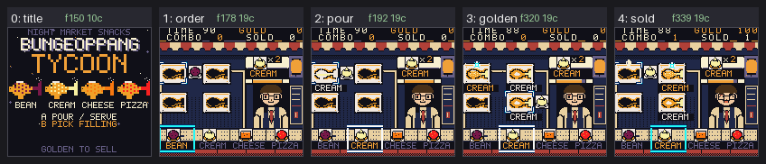

# Retro Game Creator

[English](../README.md) · [한국어](README.ko.md) · [日本語](README.ja.md) · [简体中文](README.zh.md) · [Português](README.pt.md) · [Français](README.fr.md) · [العربية](README.ar.md) · **हिन्दी**

**किसी AI कोडिंग एजेंट से गेम बनवाइए, और आपको असली Game Boy Color ROM (`.gbc`) मिलता है।**

<p align="center">
  <a href="../LICENSE"></a>
  
  
  
  
</p>

<p align="center">
  
</p>
<p align="center">
  <em>Bungeoppang Tycoon Plus — इसी किट से बना, और रिलीज़ हुए ROM से कैप्चर किया गया।
  <a href="https://github.com/dong3789/bungeoppang-tycoon-plus-gbc">रिपॉज़िटरी</a> ·
  <a href="https://github.com/dong3789/bungeoppang-tycoon-plus-gbc/releases/tag/v1.0">खेलिए</a></em>
</p>

एक स्किल दस्तावेज़ (`SKILL.md`), तीन ऑटोमेशन टूल, एक शुरुआती टेम्पलेट — और **दो पूरे गेम जो सचमुच रिलीज़ हुए**, दोनों अभी आपके बैग में रखे हैंडहेल्ड पर चलते हैं।

यह वही तरीका है जो OpenAI × ModRetro के [Chromatic](https://openai.com/en-US/supply/co-lab/chromatic/) (Game Boy संगत हैंडहेल्ड) ने दिखाया — AI C लिखता है, GBDK ROM बर्न करता है, और एम्युलेटर के फ़्रेम आँख से जाँचे जाते हैं — लेकिन $200 का यंत्र खरीदने के बजाय उसी हार्डवेयर पर जो पहले से आपके पास है।

`R36S · Miyoo Mini · Anbernic · iPhone (Delta) · डेस्कटॉप और वेब एम्युलेटर · असली हार्डवेयर` — एक `.gbc` फ़ाइल सब पर चलती है।

---

## शोकेस — इसी किट से बने गेम

दो गेम, दोनों `.gbc` के रूप में रिलीज़। दोनों उसी लूप से निकले हैं जो यह रिपॉज़िटरी लागू करती है: `SKILL.md` के हिसाब से C लिखो, GBDK-2020 से कंपाइल करो, `tools/playtest.py` से ROM को बिना स्क्रीन दोबारा चलाओ, फ़्रेम देखो, सुधारो, दोहराओ। नीचे हर एनिमेशन और स्ट्रिप **रिलीज़ हुए ROM** से लिया गया है, किसी मॉकअप से नहीं।

### 1. Bungeoppang Tycoon Plus

> रात के बाज़ार की मछली-आकार की मिठाई की दुकान, घड़ी पर 90 सेकंड।

[रिपॉज़िटरी](https://github.com/dong3789/bungeoppang-tycoon-plus-gbc) · [रिलीज़ v1.0 · `bungeoppang-plus.gbc` (32 KiB)](https://github.com/dong3789/bungeoppang-tycoon-plus-gbc/releases/tag/v1.0)

| | |
| --- | --- |
| शैली | 90 सेकंड का स्कोर-हमला कुकिंग गेम |
| लूप | ग्रिड पर चार साँचे, चार भरावन — BEAN / CREAM / CHEESE / PIZZA। घोल डालिए, सुनहरा होने तक रुकिए, और वही भरावन बेचिए जो ग्राहक ने माँगा हो |
| नियंत्रण | D-pad: साँचा चुनें · **A**: डालना / बेचना / जला हुआ खुरचना · **B**: भरावन बदलें (दबाए रखें तो दोहराता है) · **SELECT**: उलटी दिशा · **START**: शुरू, फिर से |
| गहराई | ग्राहक भरावन और धैर्य की पट्टी लेकर आता है, हर सही बिक्री पर कॉम्बो बढ़ता है, और शिफ़्ट के अंत में कमाई पर S/A/B/C रैंक (S = 6000 सोना) |
| हार्डवेयर बजट | 256 बैकग्राउंड टाइल इंडेक्स में से 246, 40 OAM स्प्राइट में से 28। चारों भरावन एक ही टाइल सेट साझा करते हैं और सिर्फ़ पैलेट से अलग दिखते हैं — बदलने में कोई VRAM नहीं लगती |
| ROM | केवल CGB (`0xC0`), 32 KiB, MBC5+RAM+बैटरी (`0x1B`) |

<p align="center"></p>

स्ट्रिप रिलीज़ हुए ROM से लिए पाँच फ़्रेम हैं: टाइटल स्क्रीन, CREAM माँगता ग्राहक, तीन साँचों में डाला घोल, सुनहरा रंग, और बिक्री (`GOLD 100 · COMBO 1`)।

### 2. RAMEN TIME

> तीन राउंड, पाँच चरण, एक बटन — और आपसे तेज़ कर्सर।

[रिपॉज़िटरी](https://github.com/dong3789/ramen-time-gbc) · [रिलीज़ v1.0 · `ramen-time.gbc` (32 KiB)](https://github.com/dong3789/ramen-time-gbc/releases/tag/v1.0)

| | |
| --- | --- |
| शैली | टाइमिंग और लय वाला कुकिंग गेम |
| लूप | **BOIL → NOODLES → SOUP → TOPPING → STOP**, हर राउंड में पाँच बार, तीन राउंड। चलते कर्सर के हरे हिस्से में होने पर दबाइए |
| नियंत्रण | **A**: टाइमिंग (TOPPING में अंडा) · **B**: हरा प्याज़ · **START**: शुरू / फिर से · **SELECT**: टाइटल पर लौटें |
| गहराई | 112 पिक्सेल के गेज के बीच के 16 पिक्सेल PERFECT (100 अंक), GOOD 60, चूके तो 0; कर्सर की गति राउंड 1 में हर 2 फ़्रेम पर 1 पिक्सेल, राउंड 2 में हर फ़्रेम 1 पिक्सेल, राउंड 3 में हर फ़्रेम 2 पिक्सेल; जल्दी रोका तो नूडल HARD, देर की तो SOGGY। पूरे अंक 1260 |
| हार्डवेयर बजट | 384 VRAM स्लॉट में 215 बैकग्राउंड + 3 स्प्राइट टाइल, 40 OAM स्प्राइट में से 3 — हर चरण में बर्तन की एक टाइल पंक्ति बदलकर दृश्य बदलता है |
| ROM | CGB समर्थित (`0x80`), 32 KiB, MBC5+RAM+बैटरी (`0x1B`) |

<p align="center"></p>

<p align="center"></p>

सबसे दाईं ओर का परिणाम कार्ड 15 चरणों के असली खेल से आया है, जिसे एम्युलेटर की मेमोरी से कर्सर स्प्राइट पढ़कर चलाया गया: रैंक **S**, अंक **1260**, *PERFECT NOODLES*।

**दोनों गेमों में जो समान है वही मुद्दा है:** इनपुट → अंक → रैंक तक पूरा लूप, सिर्फ़ पैलेट से कला की विविधता, और एक ऐसी प्लेटेस्ट स्ट्रिप जिसे इंसान सचमुच पढ़ सके। यही कसौटी यह किट माँगती है।

---

## 30 सेकंड में शुरुआत

```bash
git clone https://github.com/dong3789/retro-game-creator.git
cd retro-game-creator

./tools/check_env.sh                 # GBDK, python, pillow, pyboy
./templates/minimal-gbc/build.sh     # नमूना ROM बनाएँ → build/tile-hop.gbc

python3 tools/playtest.py --rom templates/minimal-gbc/build/tile-hop.gbc \
  --script "wait:8,press:start:4,wait:16,hold:right:36,snap:score" \
  --out build/strip.png
```

`build/strip.png` खोलिए। वही गेम है।

GBDK-2020 को [रिलीज़ पेज](https://github.com/gbdk-2020/gbdk-2020/releases) से लेकर कहीं भी खोलिए, और
`export GBDKDIR=/path/to/gbdk/` कर दीजिए (**अंत में `/` ज़रूर रखें**)। `build.sh` `/opt/gbdk`, `~/gbdk` और कुछ और जगहें भी देखता है, और `make` के बिना भी बन जाता है।

## शुरुआती टेम्पलेट — TILE HOP

`templates/minimal-gbc/` वह आधार है जिसे आप कॉपी करते हैं। यह खोखला ढाँचा नहीं है: टाइटल से लेकर खेल, अंक और क्लियर तक चलता है, इसलिए रखने लायक हर हिस्सा (`vsync()` लूप, जॉयपैड एज डिटेक्शन, टाइलमैप, स्प्राइट, ध्वनि, HUD) पहले से जुड़ा है।

| | |
| --- | --- |
| नियंत्रण | D-pad से चलें, `START` से शुरू, `SELECT` से टाइटल पर |
| लक्ष्य | छहों सितारे खा लें तो `CLEAR!`, फिर सितारे दोबारा बिछते हैं और अंक शून्य (अनंत) |
| क्या है इसमें | 5 रंग पैलेट, अलग BG/OBJ पैलेट, टाइल टक्कर, स्प्राइट एनिमेशन, ध्वनि, HUD |
| आकार | ROM 32 KiB · 384 में से 182 टाइल |

| टाइटल | खेल | क्लियर |
| --- | --- | --- |
|  |  |  |

बीच की स्ट्रिप वे फ़्रेम हैं जो `tools/playtest.py` ने असली ROM चलाकर कैप्चर किए —
टाइटल → शुरू → दाएँ चलकर सितारा लेना (SCORE 00→01, STAR 6→5) → चलना → टाइटल पर वापस।
**कसौटी "स्क्रीन पर दिख रहा है" है, "कंपाइल हो गया" नहीं।**

## कहीं भी चलाइए

`.gbc` एक मानक Game Boy Color ROM है, इसलिए वही फ़ाइल नीचे हर जगह चलती है — ऊपर के दोनों शोकेस गेम भी।

| डिवाइस | तरीका |
| --- | --- |
| **R36S (ArkOS)** | microSD के `EASYROMS` पार्टीशन में GBC फ़ोल्डर में कॉपी करें → Gambatte या SameBoy कोर (नीचे विस्तार) |
| **Miyoo Mini (Onion), Anbernic RG35XX, …** | वही तरीका — हैंडहेल्ड के GBC ROM फ़ोल्डर में डाल दें |
| **iPhone / iPad** | Delta ऐप में `.gbc` खोलें |
| **PC / Mac** | SameBoy, mGBA |
| **असली हार्डवेयर** | Game Boy Color + फ़्लैश कार्ट |

### R36S पर डालना

1. microSD को PC में लगाइए और **EASYROMS** पार्टीशन खोलिए (`BOOT` नहीं)।
2. `.gbc` को GBC फ़ोल्डर में कॉपी करें — आम तौर पर `EASYROMS/roms/gbc/`, किसी इमेज में `EASYROMS/gbc/`।
   फ़ोल्डर के नाम केस-सेंसिटिव हैं। गेम न दिखे तो गड़बड़ी फ़ोल्डर में है, ROM में नहीं।
3. चलाइए। कोर **Gambatte** (डिफ़ॉल्ट, ठीक) या **SameBoy** (सबसे सटीक)।
4. डिस्प्ले: GBC 160×144 है, यानी ठीक **10:9**, जबकि R36S का पैनल 640×480 (4:3) है।
   `Settings → Video → Scaling` में **Aspect Ratio: Core Provided** और **Integer Scale: ON → 480×432 (3×)** रखें।
   पिक्सेल साफ़ चौकोर ग्रिड पर बैठ जाते हैं। 4× (640×576) 480 पंक्तियों में नहीं आता, इसलिए 3× पर ही लौटता है।
   "Fill the screen" 10:9 को 4:3 में खींचता है, लगभग 20% चौड़ा — पिक्सेल आर्ट के लिए सुझाया नहीं जाता।

## रिपॉज़िटरी में क्या है

```
SKILL.md                  एजेंट के लिए मार्गदर्शिका — हार्डवेयर सीमाएँ, GBDK API, बिल्ड/प्लेटेस्ट लूप
AGENTS.md / CLAUDE.md     संक्षिप्त नियम जो Codex और Claude Code रूट पर पढ़ते हैं
tools/
  png2gbc.py              PNG → 8×8 2bpp टाइल + BGR555 पैलेट C कोड (+ टाइल ग्रिड पूर्वावलोकन)
  artfont.py              5×7 पिक्सेल फ़ॉन्ट से लोगो और पाठ PNG में बनाना
  playtest.py             PyBoy हेडलेस रन + कुंजी स्क्रिप्ट + स्क्रीनशॉट स्ट्रिप
  check_env.sh            GBDK / python / pillow / pyboy की जाँच
templates/minimal-gbc/    शुरुआती गेम "TILE HOP" (टाइटल → खेल → अंक → क्लियर)
docs/images/              असली ROM से लिए स्क्रीनशॉट और GIF (दोनों शोकेस गेम + TILE HOP)
docs/ci.md                पूरा CI वर्कफ़्लो + एक बार रजिस्टर करने का तरीका (अभी रिपॉज़िटरी में नहीं)
```

दोनों शोकेस गेम अपनी-अपनी रिपॉज़िटरी में हैं —
[`bungeoppang-tycoon-plus-gbc`](https://github.com/dong3789/bungeoppang-tycoon-plus-gbc) और
[`ramen-time-gbc`](https://github.com/dong3789/ramen-time-gbc) — पूरे सोर्स, बिल्ड स्क्रिप्ट और `docs/` स्क्रीनशॉट के साथ।

## अपने एजेंट से जोड़िए

| टूल | कैसे पढ़ा जाता है |
| --- | --- |
| **Claude Code** | रिपॉज़िटरी खोलते ही `CLAUDE.md` पढ़ता है। "TILE HOP कॉपी करके शूटर बना दो" कहिए, और वह `SKILL.md` के नियमों से चलता है। |
| **Codex / अन्य एजेंट** | वे `AGENTS.md` पढ़ते हैं। आपका टूल दोनों में से कोई न पढ़े तो बातचीत की शुरुआत में एक पंक्ति जोड़ दें कि `SKILL.md` पढ़े। |
| **Claude Skill फ़ॉर्मैट** | `SKILL.md` में frontmatter (`name`, `description`) है, इसलिए यह सीधे skills फ़ोल्डर में रखा जा सकता है। |

स्किल जो लागू करती है: 384 टाइल का VRAM बजट, प्रति टाइल 4 रंग, 8×8 संरेखण, OAM की 40 प्रविष्टियाँ और प्रति स्कैनलाइन 10,
`vsync()` लूप, CGB रजिस्टर गार्ड, और **बिल्ड के बाद हर बार प्लेटेस्ट स्ट्रिप खुद देखना**।

## बनाने का लूप (जैसा स्किल में लिखा है)

1. **एक पैराग्राफ़ डिज़ाइन + एक पंक्ति पास/फ़ेल** — "36 फ़्रेम दाएँ चलो, सितारा खाओ, और अंक 0→1 हो जाए"
2. **PNG आर्ट** → `tools/png2gbc.py` से टाइल और पैलेट बनाइए, पूर्वावलोकन आँख से देखिए
3. **C कोड** — `templates/minimal-gbc/src/main.c` कॉपी करके बदलिए
4. **बिल्ड** — `./build.sh` (lcc)
5. **प्लेटेस्ट** — कुंजी स्क्रिप्ट चलाइए → स्ट्रिप PNG मिलेगी
6. **स्ट्रिप खुद खोलिए** → सुधारिए और दोहराइए
7. **सबूत रखिए** — स्ट्रिप और स्क्रीनशॉट `docs/images/` में, README से जुड़े हुए

दोनों शोकेस गेम इसी लूप में तब तक घूमे जब तक स्ट्रिप देखने लायक न हुई। जहाँ स्क्रीनशॉट से ज़्यादा ऑटोमेशन काम आए, वहाँ अनुमान लगाने के बजाय गेम की स्थिति चलते समय पढ़िए: ऊपर का RAMEN TIME GIF स्प्राइट एट्रिब्यूट टेबल से टाइमिंग कर्सर पढ़कर PERFECT खिड़की में `A` दबाकर चलाया गया, और Bungeoppang का GIF फ़्रेमबफ़र से ग्राहक का ऑर्डर नमूना लेकर वही भरावन `B` से चुनकर।

## तीन टूल

```bash
# 1) आर्ट: स्प्राइट 3 रंग + पारदर्शी, बैकग्राउंड 4 रंग। --dedup डुप्लिकेट टाइल जोड़ता है, --palette पैलेट तय करता है
python3 tools/png2gbc.py assets/player.png --mode sprite --name player -o src/gen/player
python3 tools/png2gbc.py assets/level.png  --mode bg --map --dedup --name level -o src/gen/level

# 2) पाठ: लोगो और पंक्तियाँ 5×7 फ़ॉन्ट से PNG में (पूर्णांक स्केल)
python3 tools/artfont.py "PRESS START" --scale 2 --color "#FFEBC2" --out press.png

# 3) प्लेटेस्ट: wait / press / hold / release / snap
python3 tools/playtest.py --rom build/tile-hop.gbc \
  --script "wait:40,press:start:4,wait:20,snap:play,hold:right:40,release:right,snap:score" \
  --out build/strip.png
```

`playtest.py` आम गड़बड़ियाँ भी बताता है: "हर फ़्रेम एक जैसा (= इनपुट गेम तक नहीं पहुँच रहा)", "दो या कम रंग (= पैलेट/डिस्प्ले की समस्या)",
"खाली फ़्रेम"। चेतावनी को बग मानिए और ठीक कीजिए।

## हार्डवेयर चीट शीट (अधिक `SKILL.md` में)

| मद | मान |
| --- | --- |
| स्क्रीन | 160×144 (20×18 टाइल) |
| टाइल | 8×8, 2bpp = प्रति टाइल 4 रंग, 16 बाइट |
| VRAM | 384 टाइल (8 KiB) — बैकग्राउंड और स्प्राइट **एक ही जगह** साझा करते हैं |
| पैलेट | BG 8 + OBJ 8 × 4 रंग, BGR555 15-बिट |
| स्प्राइट | OAM की 40 प्रविष्टियाँ, **प्रति स्कैनलाइन 10** |
| फ़्रेम | 59.7 fps, लगभग 70,224 साइकल |
| ध्वनि | 4 चैनल (2 स्क्वेयर, 1 वेव, 1 नॉइज़) |

## CI

[`docs/ci.md`](ci.md) में पूरा वर्कफ़्लो है — Ubuntu रनर GBDK-2020 4.5.0 लाता है,
`templates/minimal-gbc` बनाता है, ROM हेडर (साइज़, टाइटल, कार्ट प्रकार `0x1B`, CGB फ़्लैग `0x80`) जाँचता है,
PyBoy प्लेटेस्ट `--strict` के साथ चलाता है, और `.gbc` तथा स्क्रीनशॉट स्ट्रिप आर्टिफ़ैक्ट के रूप में अपलोड करता है।

> इस रिपॉज़िटरी में `.github/workflows/build-rom.yml` अभी **रजिस्टर नहीं** है। पहले पुश में इस्तेमाल हुए
> GitHub टोकन के पास `workflows` अनुमति नहीं थी, इसलिए GitHub ने वह फ़ाइल अस्वीकार कर दी। `docs/ci.md` की फ़ाइल
> एक बार वेब UI में चिपका दीजिए, फिर वह हर पुश पर चलेगी।

## श्रेय

- कंपाइलर: [GBDK-2020](https://github.com/gbdk-2020/gbdk-2020) (SDCC पर आधारित)
- एम्युलेटर: [PyBoy](https://github.com/Baekalfen/PyBoy) — हेडलेस समीक्षा के लिए
- संदर्भ: Pan Docs (Game Boy हार्डवेयर), GBDK 2020 Docs
- प्रेरणा: OpenAI × ModRetro **Chromatic: Codex Edition**

MIT License — [LICENSE](../LICENSE) देखें। गेम बनाइए, बदलिए, बेचिए।
सवाल और बग [Issues](https://github.com/dong3789/retro-game-creator/issues) पर; इस किट से बने गेम हमेशा स्वागत योग्य हैं।
