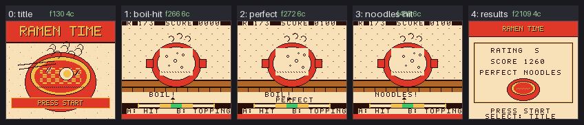
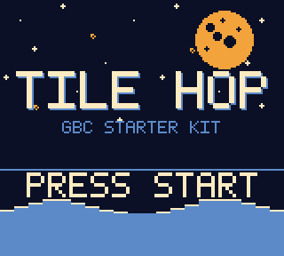
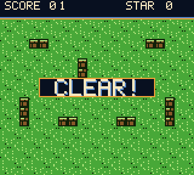

# Retro Game Creator

[English](../README.md) · **한국어** · [日本語](README.ja.md) · [简体中文](README.zh.md) · [Português](README.pt.md) · [Français](README.fr.md) · [العربية](README.ar.md) · [हिन्दी](README.hi.md)

**AI 에이전트에게 게임을 시키면, 진짜 게임보이 컬러 ROM(`.gbc`)이 나옵니다.**

<p align="center">
  <a href="../LICENSE"></a>
  
  
  
  
</p>

<p align="center">
  
</p>
<p align="center">
  <em>붕어빵 타이쿤 Plus — 이 킷으로 만들고, 공개된 롬에서 그대로 캡처했습니다.
  <a href="https://github.com/dong3789/bungeoppang-tycoon-plus-gbc">저장소</a> ·
  <a href="https://github.com/dong3789/bungeoppang-tycoon-plus-gbc/releases/tag/v1.0">바로 플레이</a></em>
</p>

스킬 문서 하나(`SKILL.md`)와 자동화 도구 3개, 시작용 템플릿 — 그리고 **실제로 세상에 나간 게임 두 개**가 들어 있습니다. 둘 다 지금 가방에 있는 휴대기에서 바로 돌아갑니다.

OpenAI × ModRetro의 [Chromatic](https://openai.com/ko-KR/supply/co-lab/chromatic/)(게임보이 하드웨어 호환 휴대기기)이 보여 준 "AI가 C를 쓰고 → GBDK로 ROM을 굽고 → 에뮬레이터 프레임을 눈으로 검수한다"는 흐름을, $200 기기를 사지 않고 이미 있는 기기에서 그대로 쓰도록 만들었습니다.

`R36S · Miyoo Mini · Anbernic · iPhone(Delta) · PC/웹 에뮬레이터 · 실기` — `.gbc` 파일 하나로 전부 돌아갑니다.

---

## 쇼케이스 — 이 킷으로 만든 게임

게임 두 개, 둘 다 `.gbc`로 공개했습니다. 이 저장소가 강제하는 것과 똑같은 루프에서 나왔습니다: `SKILL.md`를 보고 C를 쓰고, GBDK-2020으로 컴파일하고, `tools/playtest.py`로 롬을 헤드리스 재생하고, 프레임을 눈으로 보고, 고치고, 반복. 아래 움직이는 화면과 스트립은 전부 **공개된 롬**에서 캡처한 것이지, 목업이 아닙니다.

### 1. 붕어빵 타이쿤 Plus

> 밤시장 붕어빵 가게, 제한 시간 90초.

[저장소](https://github.com/dong3789/bungeoppang-tycoon-plus-gbc) · [릴리스 v1.0 · `bungeoppang-plus.gbc` (32 KiB)](https://github.com/dong3789/bungeoppang-tycoon-plus-gbc/releases/tag/v1.0)

| | |
| --- | --- |
| 장르 | 90초 점수 공략 요리 게임 |
| 루프 | 석쇠에 틀 네 개, 속재료는 BEAN / CREAM / CHEESE / PIZZA. 반죽을 붓고, 황금색이 되면 손님이 시킨 속으로 팝니다 |
| 조작 | 십자 버튼: 틀 선택 · **A**: 붓기 / 판매 / 탄 것 긁기 · **B**: 속 바꾸기(길게 누르면 반복) · **SELECT**: 반대 방향 · **START**: 시작·다시 하기 |
| 깊이 | 손님은 속재료와 인내심 게이지를 들고 옵니다. 제대로 팔 때마다 콤보가 쌓이고, 90초가 끝나면 매출로 S/A/B/C 등급(S = 6000골드) |
| 하드웨어 예산 | 배경 타일 인덱스 256개 중 246개, OAM 스프라이트 40개 중 28개. 속재료 네 가지는 타일을 공유하고 팔레트만 바꿔 그립니다 — 전환에 VRAM이 들지 않습니다 |
| 롬 | CGB 전용(`0xC0`), 32 KiB, MBC5+RAM+배터리(`0x1B`) |

<p align="center"></p>

스트립은 공개된 롬에서 뽑은 다섯 프레임입니다: 타이틀 화면, CREAM을 요구하는 손님, 반죽을 부은 세 틀, 황금색, 그리고 판매(`GOLD 100 · COMBO 1`).

### 2. RAMEN TIME

> 세 라운드, 다섯 단계, 버튼 하나 — 그리고 당신보다 빠른 커서.

[저장소](https://github.com/dong3789/ramen-time-gbc) · [릴리스 v1.0 · `ramen-time.gbc` (32 KiB)](https://github.com/dong3789/ramen-time-gbc/releases/tag/v1.0)

| | |
| --- | --- |
| 장르 | 타이밍·리듬 요리 게임 |
| 루프 | **BOIL → NOODLES → SOUP → TOPPING → STOP**, 라운드마다 다섯 단계, 세 라운드. 움직이는 커서가 초록 구간에 있을 때 누릅니다 |
| 조작 | **A**: 타이밍 맞추기(TOPPING에서는 계란) · **B**: 파 넣기 · **START**: 시작 / 다시 하기 · **SELECT**: 타이틀로 |
| 깊이 | 112픽셀 게이지 가운데 16픽셀이 PERFECT(100점), GOOD은 60점, 빗나가면 0점. 커서 속도는 1라운드 2프레임당 1픽셀, 2라운드 프레임당 1픽셀, 3라운드 프레임당 2픽셀. 너무 빨리 멈추면 면이 HARD, 늦으면 SOGGY. 만점은 1260점 |
| 하드웨어 예산 | VRAM 384칸 중 배경 215 + 스프라이트 3, OAM 40개 중 3개 — 단계마다 냄비 타일 한 줄만 바꿔 그립니다 |
| 롬 | CGB 대응(`0x80`), 32 KiB, MBC5+RAM+배터리(`0x1B`) |

<p align="center"></p>

<p align="center"></p>

맨 오른쪽 결과 카드는 에뮬레이터 메모리에서 커서 스프라이트를 읽어 15단계를 실제로 플레이한 결과입니다: 등급 **S**, 점수 **1260**, *PERFECT NOODLES*.

**두 게임의 공통점이 핵심입니다:** 입력 → 점수 → 등급까지 도는 완결된 루프, 팔레트만 바꾸는 아트 변주, 그리고 사람이 실제로 읽을 수 있는 플레이테스트 스트립. 이 킷이 요구하는 기준이 그것입니다.

---

## 30초 시작

```bash
git clone https://github.com/dong3789/retro-game-creator.git
cd retro-game-creator

./tools/check_env.sh                 # GBDK·python·pillow·pyboy 점검
./templates/minimal-gbc/build.sh     # 예제 ROM 빌드 → build/tile-hop.gbc

python3 tools/playtest.py --rom templates/minimal-gbc/build/tile-hop.gbc \
  --script "wait:8,press:start:4,wait:16,hold:right:36,snap:score" \
  --out build/strip.png
```

`build/strip.png`를 열어 보세요. 그게 게임입니다.

GBDK-2020은 [릴리스](https://github.com/gbdk-2020/gbdk-2020/releases)에서 받아 아무 데나 풀고
`export GBDKDIR=/경로/gbdk/` (**끝에 `/` 꼭**) 하면 됩니다. `build.sh`가 `/opt/gbdk`, `~/gbdk` 등도 알아서 찾고, `make`가 없어도 빌드됩니다.

## 시작용 템플릿 — TILE HOP

`templates/minimal-gbc/`는 복사해서 시작하는 베이스입니다. 빈 껍데기가 아니라 타이틀 → 플레이 → 점수 → 클리어까지 도는 게임이라, 남겨야 할 조각(vsync 루프, 조이패드 엣지 검출, 타일맵, 스프라이트, 사운드, HUD)이 이미 다 붙어 있습니다.

| | |
| --- | --- |
| 조작 | 방향키 이동, `START` 시작, `SELECT` 타이틀로 |
| 목표 | 별 6개를 다 먹으면 `CLEAR!`, 별이 다시 깔리고 점수 리셋 (무한 반복) |
| 구현된 것 | 컬러 팔레트 5종, BG/OBJ 팔레트 분리, 타일 충돌, 스프라이트 애니메이션, 사운드, HUD |
| 크기 | ROM 32 KiB · 타일 182개 / VRAM 384개 |

| 타이틀 | 플레이 | 클리어 |
| --- | --- | --- |
|  |  |  |

가운데 스트립은 `tools/playtest.py`가 실제로 ROM을 돌리며 찍은 프레임입니다 —
타이틀 → 시작 → 오른쪽으로 걸어가 별 획득(SCORE 00→01, STAR 6→5) → 이동 → 타이틀 복귀.
**"빌드됐다"가 아니라 "화면에서 확인했다"** 가 이 킷의 기준입니다.

## 어디서나 실행하기

`.gbc`는 표준 게임보이 컬러 롬이라, 같은 파일이 아래 어디서든 그대로 돕니다 — 위의 쇼케이스 게임 두 개도 마찬가지입니다.

| 기기 | 방법 |
| --- | --- |
| **R36S (ArkOS)** | 마이크로SD `EASYROMS` 파티션의 GBC 폴더에 복사 → Gambatte 또는 SameBoy 코어 (아래 상세) |
| **Miyoo Mini (Onion), Anbernic RG35XX 등** | 같은 요령 — SD카드의 GBC 롬 폴더에 넣으면 끝 |
| **iPhone / iPad** | Delta 앱에서 `.gbc` 파일 열기 |
| **PC / Mac** | SameBoy, mGBA |
| **실기** | 게임보이 컬러 + 플래시카트 |

### R36S에 넣기

1. 마이크로SD를 PC에 꽂고 **EASYROMS** 파티션을 엽니다 (`BOOT` 파티션이 아닙니다).
2. GBC 폴더에 `.gbc`를 복사합니다 — 보통 `EASYROMS/roms/gbc/` (이미지에 따라 `EASYROMS/gbc/`).
   폴더 이름은 대소문자를 구분합니다. 게임이 안 보이면 롬이 아니라 폴더가 틀린 겁니다.
3. 실행. 코어는 **Gambatte**(기본, 무난) 또는 **SameBoy**(가장 정확).
4. 화면 설정: GBC는 160×144 = 정확히 **10:9**, R36S 패널은 640×480(4:3)입니다.
   `설정 → 비디오 → 스케일링`에서 **Aspect Ratio: Core Provided + Integer Scale: ON → 480×432 (3배)**.
   픽셀이 정사각으로 딱 떨어집니다. 4배(640×576)는 세로 480에 안 들어가서 결국 3배로 떨어집니다.
   "화면 꽉 채우기"는 10:9를 4:3에 밀어넣어 약 20% 늘어납니다 — 픽셀아트에는 비추천.

## 들어 있는 것

```
SKILL.md                  AI 에이전트용 본문 — 하드웨어 제약, GBDK API, 제작·검수 루프
AGENTS.md / CLAUDE.md     Codex · Claude Code가 레포 루트에서 바로 읽는 요약 규칙
tools/
  png2gbc.py              PNG → 8×8 2bpp 타일 + BGR555 팔레트 C 코드 (+ 타일 그리드 미리보기)
  artfont.py              5×7 픽셀 폰트로 로고·문구를 PNG에 그리기
  playtest.py             PyBoy 헤드리스 실행 + 키 입력 시퀀스 + 스크린샷 스트립
  check_env.sh            GBDK / python / pillow / pyboy 점검
templates/minimal-gbc/    시작용 게임 "TILE HOP" (타이틀 → 플레이 → 점수 → 클리어)
docs/images/              실제 롬에서 캡처한 화면과 GIF (쇼케이스 두 게임 + TILE HOP)
docs/ci.md                CI 워크플로 전문 + 1회 등록 방법 (아직 저장소에 미등록)
```

쇼케이스 게임 두 개는 각자 저장소에 있습니다 —
[`bungeoppang-tycoon-plus-gbc`](https://github.com/dong3789/bungeoppang-tycoon-plus-gbc),
[`ramen-time-gbc`](https://github.com/dong3789/ramen-time-gbc) — 소스, 빌드 스크립트, `docs/` 스크린샷까지 전부 들어 있습니다.

## AI 에이전트에 붙이기

| 도구 | 어떻게 읽히나 |
| --- | --- |
| **Claude Code** | 레포에서 열면 `CLAUDE.md`를 읽습니다. "TILE HOP 복사해서 슈팅 게임으로 바꿔줘"처럼 시키면 `SKILL.md` 규칙대로 진행합니다. |
| **Codex / 기타 에이전트** | `AGENTS.md`를 읽습니다. 안 읽는 도구라면 대화 첫머리에 `SKILL.md`를 읽으라고 한 줄 붙이면 됩니다. |
| **Claude Skill 형식** | `SKILL.md`가 frontmatter(`name`, `description`)를 갖춘 표준 스킬 문서라 그대로 스킬 폴더에 넣어도 됩니다. |

스킬이 강제하는 것: 384타일 VRAM 예산, 4색/타일, 8×8 정렬, OAM 40개·스캔라인 10개,
`vsync()` 루프, CGB 레지스터 가드, 그리고 **빌드 후 반드시 플레이테스트 스트립을 눈으로 볼 것**.

## 만드는 순서 (스킬에 적힌 루프)

1. **기획 한 문단 + 합격 기준 한 줄** — "오른쪽으로 36프레임 걸으면 별을 먹고 점수가 0→1이 된다"
2. **PNG 아트** → `tools/png2gbc.py`로 타일·팔레트 변환, 미리보기로 눈 확인
3. **C 코드** — `templates/minimal-gbc/src/main.c`를 복사해서 고침
4. **빌드** — `./build.sh` (lcc)
5. **플레이테스트** — 키 입력 스크립트 실행 → 스트립 PNG 생성
6. **스트립을 직접 열어 검수** → 고치고 반복
7. **증거 남기기** — 스트립/스크린샷을 `docs/images/`에, README에 링크

쇼케이스 게임 두 개도 스트립이 볼 만해질 때까지 이 루프를 돌았습니다. 스크린샷보다 자동화가 더 값어치 있을 때는, 추측 대신 게임 상태를 실행 중에 직접 읽으면 됩니다. 위의 RAMEN TIME GIF는 스프라이트 속성 테이블에서 타이밍 커서 위치를 읽어 PERFECT 구간에서 `A`를 누르게 만들었고, 붕어빵 GIF는 화면에서 손님 주문을 샘플링해 그 속재료를 `B`로 고르게 만들었습니다.

## 도구 세 개

```bash
# 1) 아트:  sprite는 3색+투명, bg는 4색. --dedup으로 타일 중복 제거, --palette로 팔레트 고정
python3 tools/png2gbc.py assets/player.png --mode sprite --name player -o src/gen/player
python3 tools/png2gbc.py assets/level.png  --mode bg --map --dedup --name level -o src/gen/level

# 2) 글자: 로고/문구를 5×7 폰트로 PNG에 그리기 (정수 배율)
python3 tools/artfont.py "PRESS START" --scale 2 --color "#FFEBC2" --out press.png

# 3) 플레이테스트: wait/press/hold/release/snap
python3 tools/playtest.py --rom build/tile-hop.gbc \
  --script "wait:40,press:start:4,wait:20,snap:play,hold:right:40,release:right,snap:score" \
  --out build/strip.png
```

`playtest.py`는 "모든 프레임이 똑같다(= 입력이 안 들어간다)", "색이 2개 이하(= 팔레트/디스플레이 문제)",
"빈 프레임" 같은 전형적 실패를 경고로 짚어 줍니다. 경고가 뜨면 버그로 보고 고치세요.

## 하드웨어 요약 (자세한 건 `SKILL.md`)

| 항목 | 값 |
| --- | --- |
| 화면 | 160×144 (20×18 타일) |
| 타일 | 8×8, 2bpp = 타일당 4색, 16바이트 |
| VRAM | 384타일(8 KiB) — 배경·스프라이트가 **같은 곳**을 씀 |
| 팔레트 | BG 8개 + OBJ 8개 × 4색, BGR555 15비트 |
| 스프라이트 | OAM 40개, **스캔라인당 10개** |
| 프레임 | 59.7 fps, 약 70,224 사이클 |
| 사운드 | 4채널 (스퀘어2·웨이브·노이즈) |

## CI

[`docs/ci.md`](ci.md)에 워크플로 전문이 있습니다 — 우분투 러너에서 GBDK-2020 4.5.0을 받아
`templates/minimal-gbc`를 빌드하고, ROM 헤더(크기·타이틀·카트 타입 `0x1B`·CGB 플래그 `0x80`)를 검사하고,
PyBoy 플레이테스트(`--strict`)까지 돌린 뒤 `.gbc`와 스크린샷 스트립을 아티팩트로 올립니다.

> 이 저장소에는 아직 `.github/workflows/build-rom.yml`이 **등록되어 있지 않습니다.**
> 처음 올린 GitHub 토큰에 `workflows` 권한이 없어 GitHub이 해당 파일 푸시를 거부했기 때문입니다.
> `docs/ci.md`의 파일을 웹 UI에서 한 번 붙여넣으면 그때부터 매 푸시마다 실행됩니다.

## 크레딧

- 컴파일러: [GBDK-2020](https://github.com/gbdk-2020/gbdk-2020) (SDCC 기반)
- 에뮬레이터: [PyBoy](https://github.com/Baekalfen/PyBoy) — 헤드리스 검수용
- 레퍼런스: Pan Docs (게임보이 하드웨어 문서), GBDK 2020 Docs
- 영감: OpenAI × ModRetro **Chromatic: Codex Edition**

MIT License — [LICENSE](../LICENSE) 참고. 게임을 만들고, 고치고, 팔아도 됩니다.
질문·버그는 [Issues](https://github.com/dong3789/retro-game-creator/issues)에, 이 킷으로 만든 게임 자랑은 언제나 환영합니다.
