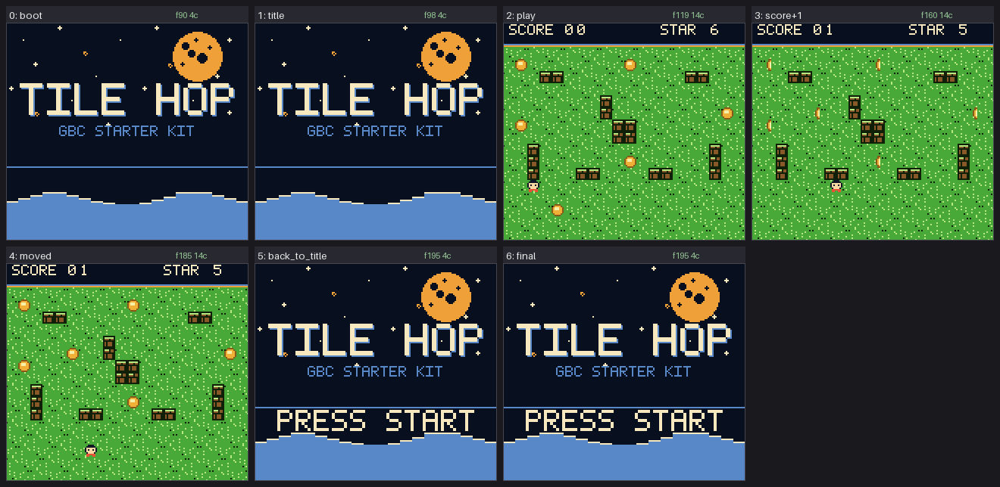

# Retro Game Creator

[English](../README.md) · [한국어](README.ko.md) · [日本語](README.ja.md) · [简体中文](README.zh.md) · **Português** · [Français](README.fr.md) · [العربية](README.ar.md) · [हिन्दी](README.hi.md)

**Peça um jogo a um agente de código de IA e receba um ROM de Game Boy Color de verdade (`.gbc`).**

<p align="center">
  <a href="../LICENSE"></a>
  
  
  
  
</p>

<p align="center">
  
</p>
<p align="center">
  <em>Bungeoppang Tycoon Plus — feito com este kit, capturado do ROM publicado.
  <a href="https://github.com/dong3789/bungeoppang-tycoon-plus-gbc">repositório</a> ·
  <a href="https://github.com/dong3789/bungeoppang-tycoon-plus-gbc/releases/tag/v1.0">jogar</a></em>
</p>

Um documento de skill (`SKILL.md`), três ferramentas de automação, um template de partida — e **dois jogos completos que saíram do forno**, ambos jogáveis no portátil que já está na sua mochila.

É o fluxo que a [Chromatic](https://openai.com/en-US/supply/co-lab/chromatic/) da OpenAI × ModRetro (um portátil compatível com Game Boy) mostrou — a IA escreve C, o GBDK grava um ROM e os frames do emulador são conferidos a olho — rodando no hardware que você já tem, em vez de um aparelho de US$ 200.

`R36S · Miyoo Mini · Anbernic · iPhone (Delta) · emuladores de desktop e web · hardware real` — um arquivo `.gbc` roda em todos.

---

## Vitrine — feito com este kit

Dois jogos, ambos publicados como `.gbc`. Saíram do mesmo ciclo que este repositório exige: escrever C seguindo o `SKILL.md`, compilar com GBDK-2020, reexecutar o ROM sem tela com `tools/playtest.py`, olhar os frames, corrigir, repetir. Toda animação e tira abaixo foi capturada do **ROM publicado** — não é mockup.

### 1. Bungeoppang Tycoon Plus

> Uma barraca de bolo de peixe na feira noturna, 90 segundos no relógio.

[Repositório](https://github.com/dong3789/bungeoppang-tycoon-plus-gbc) · [Release v1.0 · `bungeoppang-plus.gbc` (32 KiB)](https://github.com/dong3789/bungeoppang-tycoon-plus-gbc/releases/tag/v1.0)

| | |
| --- | --- |
| Gênero | Simulador de cozinha de 90 segundos, corrida por pontos |
| O ciclo | Quatro formas na chapa, quatro recheios — BEAN / CREAM / CHEESE / PIZZA. Despeje a massa, espere dourar e venda o recheio que o cliente pediu |
| Controles | Direcional: escolher a forma · **A**: despejar / servir / raspar a queimada · **B**: trocar recheio (segure para repetir) · **SELECT**: inverter · **START**: começar, recomeçar |
| Profundidade | O cliente chega com um recheio e uma barra de paciência, o combo cresce a cada venda certa e o turno termina com nota S/A/B/C sobre o faturamento (S = 6000 de ouro) |
| Orçamento de hardware | 246 dos 256 índices de tile de fundo, 28 dos 40 sprites de OAM. Os quatro recheios compartilham os mesmos tiles e mudam só pela paleta — trocar não custa VRAM |
| ROM | Só CGB (`0xC0`), 32 KiB, MBC5+RAM+bateria (`0x1B`) |

<p align="center"></p>

A tira são cinco quadros tirados do ROM publicado: a tela de título, um cliente pedindo CREAM, massa na primeira forma, o dourado e a venda (`GOLD 100 · COMBO 1`).

### 2. Ramen Time

> Três rodadas, cinco etapas, um botão — e um cursor mais rápido que você.

[Repositório](https://github.com/dong3789/ramen-time-gbc) · [Release v1.0 · `ramen-time.gbc` (32 KiB)](https://github.com/dong3789/ramen-time-gbc/releases/tag/v1.0)

| | |
| --- | --- |
| Gênero | Jogo de cozinha por ritmo e precisão |
| O ciclo | **BOIL → NOODLES → SOUP → TOPPING → STOP**, cinco vezes por rodada, três rodadas. Acerte o cursor dentro da janela verde |
| Controles | **A**: acertar o tempo (e pôr o ovo em TOPPING) · **B**: cebolinha · **START**: começar / jogar de novo · **SELECT**: voltar ao título |
| Profundidade | PERFECT são os 16 px centrais de uma barra de 112 px (100 pts), GOOD vale 60, erro vale 0; o cursor anda 1 px a cada 2 frames na rodada 1, 1 px por frame na 2 e 2 px por frame na 3; parar cedo deixa o macarrão HARD, tarde deixa SOGGY. 1260 é uma partida perfeita |
| Orçamento de hardware | 215 tiles de fundo + 3 de sprite dos 384 espaços de VRAM, 3 dos 40 sprites de OAM — a panela muda trocando uma linha de tiles por etapa |
| ROM | Compatível com CGB (`0x80`), 32 KiB, MBC5+RAM+bateria (`0x1B`) |

<p align="center"></p>

<p align="center"></p>

O cartão de resultado à direita veio de uma partida real de 15 etapas, jogada lendo o sprite do cursor na memória do emulador: nota **S**, **1260** pontos, *PERFECT NOODLES*.

**O que os dois jogos têm em comum é o ponto:** um ciclo completo de entrada → pontuação → nota, variação de arte só por paleta e uma tira de playtest que uma pessoa consegue ler. Essa é a régua que este kit exige.

---

## Começo em 30 segundos

```bash
git clone https://github.com/dong3789/retro-game-creator.git
cd retro-game-creator

./tools/check_env.sh                 # GBDK, python, pillow, pyboy
./templates/minimal-gbc/build.sh     # compila o ROM de exemplo → build/tile-hop.gbc

python3 tools/playtest.py --rom templates/minimal-gbc/build/tile-hop.gbc \
  --script "wait:8,press:start:4,wait:16,hold:right:36,snap:score" \
  --out build/strip.png
```

Abra `build/strip.png`. Esse é o jogo.

Baixe o GBDK-2020 na [página de releases](https://github.com/gbdk-2020/gbdk-2020/releases), descompacte em qualquer lugar e
`export GBDKDIR=/caminho/para/gbdk/` (**mantenha a `/` no final**). O `build.sh` também procura em `/opt/gbdk`, `~/gbdk` e alguns outros lugares, e compila sem `make`.

## Template de partida — TILE HOP

`templates/minimal-gbc/` é a base que você copia. Não é uma casca vazia: vai da tela de título ao jogo, à pontuação e ao clear, então cada peça que você precisa manter (loop com `vsync()`, detecção de borda do joypad, tilemap, sprite, som, HUD) já está ligada.

| | |
| --- | --- |
| Controles | Direcional para andar, `START` para começar, `SELECT` para voltar ao título |
| Objetivo | Coma as 6 estrelas para `CLEAR!`, então as estrelas são redistribuídas e a pontuação zera (infinito) |
| O que tem dentro | 5 paletas de cor, paletas BG/OBJ separadas, colisão por tile, animação de sprite, som, HUD |
| Tamanho | ROM 32 KiB · 182 de 384 tiles de VRAM |

| Título | Jogo | Clear |
| --- | --- | --- |
|  |  |  |

A tira do meio são frames que `tools/playtest.py` capturou rodando o ROM de verdade —
título → start → andar para a direita e pegar uma estrela (SCORE 00→01, STAR 6→5) → mover → voltar ao título.
**A régua é "aparece na tela", não "compilou".**

## Rode em qualquer lugar

`.gbc` é um ROM padrão de Game Boy Color, então o mesmo arquivo roda em tudo abaixo — inclusive nos dois jogos da vitrine.

| Aparelho | Como |
| --- | --- |
| **R36S (ArkOS)** | Copie para a pasta GBC na partição `EASYROMS` do microSD → núcleo Gambatte ou SameBoy (detalhes abaixo) |
| **Miyoo Mini (Onion), Anbernic RG35XX, …** | Mesma ideia — jogue na pasta de ROMs GBC do portátil |
| **iPhone / iPad** | Abra o `.gbc` no app Delta |
| **PC / Mac** | SameBoy, mGBA |
| **Hardware real** | Game Boy Color + flashcart |

### Colocando no R36S

1. Ponha o microSD no PC e abra a partição **EASYROMS** (não a `BOOT`).
2. Copie o `.gbc` para a pasta GBC — normalmente `EASYROMS/roms/gbc/`, às vezes `EASYROMS/gbc/` conforme a imagem.
   Os nomes diferenciam maiúsculas de minúsculas. Se o jogo não aparece, a pasta está errada, não o ROM.
3. Inicie. Use o núcleo **Gambatte** (padrão, serve bem) ou **SameBoy** (o mais preciso).
4. Vídeo: o GBC é 160×144, exatamente **10:9**, e a tela do R36S é 640×480 (4:3).
   Em `Settings → Video → Scaling`, deixe **Aspect Ratio: Core Provided** e **Integer Scale: ON → 480×432 (3×)**.
   Os pixels caem numa grade quadrada limpa. 4× (640×576) não cabe em 480 linhas, então volta para 3× de qualquer jeito.
   "Preencher a tela" estica 10:9 para 4:3, uns 20% mais largo — não recomendado para pixel art.

## O que tem no repositório

```
SKILL.md                  o guia para o agente — limites de hardware, API do GBDK, ciclo de build/playtest
AGENTS.md / CLAUDE.md     regras resumidas que Codex e Claude Code leem na raiz do repositório
tools/
  png2gbc.py              PNG → tiles 8×8 2bpp + código C de paleta BGR555 (+ prévia da grade de tiles)
  artfont.py              desenha logos e textos em PNG com fonte de 5×7 pixels
  playtest.py             execução headless no PyBoy + script de teclas + tira de capturas
  check_env.sh            confere GBDK / python / pillow / pyboy
templates/minimal-gbc/    o jogo de partida "TILE HOP" (título → jogo → pontos → clear)
docs/images/              capturas e GIFs tirados de ROMs reais (os dois jogos da vitrine + TILE HOP)
docs/ci.md                o workflow de CI completo + como registrá-lo uma vez (ainda fora do repositório)
```

Os dois jogos da vitrine vivem em repositórios próprios —
[`bungeoppang-tycoon-plus-gbc`](https://github.com/dong3789/bungeoppang-tycoon-plus-gbc) e
[`ramen-time-gbc`](https://github.com/dong3789/ramen-time-gbc) — com código, scripts de build e as capturas em `docs/`.

## Ligue no seu agente

| Ferramenta | Como é lido |
| --- | --- |
| **Claude Code** | Abra o repositório e ele lê o `CLAUDE.md`. Peça algo como "copie o TILE HOP e transforme num shooter" e ele segue as regras do `SKILL.md`. |
| **Codex / outros agentes** | Leem o `AGENTS.md`. Se o seu não lê nenhum dos dois, cole uma linha no começo da conversa mandando ler o `SKILL.md`. |
| **Formato Claude Skill** | O `SKILL.md` tem frontmatter (`name`, `description`), então entra direto numa pasta de skills. |

O que a skill impõe: orçamento de 384 tiles de VRAM, 4 cores por tile, alinhamento 8×8, 40 entradas de OAM com 10 por scanline,
loop com `vsync()`, proteções nos registradores CGB e **sempre olhar a tira de playtest depois de compilar**.

## O ciclo (como está escrito na skill)

1. **Um parágrafo de design + uma linha de passa/falha** — "ande 36 frames para a direita, coma uma estrela e a pontuação vai de 0 a 1"
2. **Arte em PNG** → converta tiles e paletas com `tools/png2gbc.py`, confira a prévia a olho
3. **Código C** — copie `templates/minimal-gbc/src/main.c` e altere
4. **Build** — `./build.sh` (lcc)
5. **Playtest** — rode um script de teclas → receba uma tira PNG
6. **Abra a tira você mesmo** → corrija e repita
7. **Guarde a evidência** — tiras e capturas em `docs/images/`, linkadas no README

Os dois jogos da vitrine passaram por esse ciclo até a tira valer a pena olhar. Quando a automação vale mais que uma captura, leia o estado do próprio jogo em execução em vez de adivinhar: o GIF do Ramen Time foi dirigido lendo o cursor na tabela de atributos de sprites e apertando `A` dentro da janela perfeita, e o do Bungeoppang amostrando o pedido do cliente no framebuffer e escolhendo o recheio com `B`.

## Três ferramentas

```bash
# 1) arte: sprites têm 3 cores + transparência, fundos 4 cores.
#    --dedup junta tiles repetidos, --palette fixa a paleta
python3 tools/png2gbc.py assets/player.png --mode sprite --name player -o src/gen/player
python3 tools/png2gbc.py assets/level.png  --mode bg --map --dedup --name level -o src/gen/level

# 2) texto: desenhe logos e frases em PNG com fonte 5×7 (escala inteira)
python3 tools/artfont.py "PRESS START" --scale 2 --color "#FFEBC2" --out press.png

# 3) playtest: wait / press / hold / release / snap
python3 tools/playtest.py --rom build/tile-hop.gbc \
  --script "wait:40,press:start:4,wait:20,snap:play,hold:right:40,release:right,snap:score" \
  --out build/strip.png
```

O `playtest.py` também aponta as falhas clássicas: "todos os frames são iguais (= a entrada não chega ao jogo)",
"duas cores ou menos (= problema de paleta/display)", "frame em branco". Trate o aviso como bug e conserte.

## Cartão de referência de hardware (mais em `SKILL.md`)

| Item | Valor |
| --- | --- |
| Tela | 160×144 (20×18 tiles) |
| Tile | 8×8, 2bpp = 4 cores por tile, 16 bytes |
| VRAM | 384 tiles (8 KiB) — fundo e sprites dividem **o mesmo espaço** |
| Paletas | 8 BG + 8 OBJ × 4 cores, BGR555 de 15 bits |
| Sprites | 40 entradas de OAM, **10 por scanline** |
| Frame | 59,7 fps, ~70.224 ciclos |
| Som | 4 canais (2 de onda quadrada, 1 de onda, 1 de ruído) |

## CI

[`docs/ci.md`](ci.md) tem o workflow completo — um runner Ubuntu baixa o GBDK-2020 4.5.0, compila
`templates/minimal-gbc`, confere o cabeçalho do ROM (tamanho, título, tipo de cartucho `0x1B`, flag CGB `0x80`), roda o
playtest do PyBoy com `--strict` e sobe o `.gbc` e a tira de capturas como artefatos.

> Este repositório ainda **não tem** `.github/workflows/build-rom.yml` registrado. O token do GitHub usado no
> primeiro push não tinha a permissão `workflows`, então o GitHub recusou o arquivo. Cole o arquivo de `docs/ci.md`
> uma vez na interface web e ele passa a rodar a cada push.

## Créditos

- Compilador: [GBDK-2020](https://github.com/gbdk-2020/gbdk-2020) (sobre o SDCC)
- Emulador: [PyBoy](https://github.com/Baekalfen/PyBoy) — para revisão headless
- Referências: Pan Docs (hardware do Game Boy), GBDK 2020 Docs
- Inspiração: OpenAI × ModRetro **Chromatic: Codex Edition**

MIT License — veja [LICENSE](../LICENSE). Faça jogos, modifique, venda.
Dúvidas e bugs vão para as [Issues](https://github.com/dong3789/retro-game-creator/issues); jogos feitos com este kit são sempre bem-vindos.
