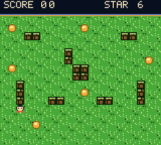

# Retro Game Creator

[English](../README.md) · [한국어](README.ko.md) · [日本語](README.ja.md) · [简体中文](README.zh.md) · **Português** · [Français](README.fr.md) · [العربية](README.ar.md) · [हिन्दी](README.hi.md)

**Peça a um agente de programação com IA para fazer um jogo e você recebe uma ROM real de Game Boy Color (`.gbc`).**

<p align="center">
  <a href="../LICENSE"></a>
  
  
  
</p>

<p align="center">
  
</p>

Um documento de skill (`SKILL.md`), três ferramentas de automação e um jogo de exemplo que foi de fato compilado e aprovado no playtest.

O kit pega o fluxo que o [Chromatic](https://openai.com/pt-BR/supply/co-lab/chromatic/) da OpenAI × ModRetro (um portátil compatível com o hardware do Game Boy) demonstrou — a IA escreve em C, o GBDK gera a ROM e os quadros do emulador são conferidos a olho — e faz isso rodar no hardware que você já tem, em vez de um aparelho de US$ 200.

`R36S · Miyoo Mini · Anbernic · iPhone (Delta) · emuladores de PC e web · hardware real` — um único arquivo `.gbc` roda em todos.

---

## Comece em 30 segundos

```bash
git clone https://github.com/dong3789/retro-game-creator.git
cd retro-game-creator

./tools/check_env.sh                 # GBDK, python, pillow, pyboy
./templates/minimal-gbc/build.sh     # compila o ROM de exemplo → build/tile-hop.gbc

python3 tools/playtest.py --rom templates/minimal-gbc/build/tile-hop.gbc \
  --script "wait:8,press:start:4,wait:16,hold:right:36,snap:score" \
  --out build/strip.png
```

Abra `build/strip.png`. Esse é o jogo.

Baixe o GBDK-2020 na [página de releases](https://github.com/gbdk-2020/gbdk-2020/releases), descompacte em qualquer lugar e
`export GBDKDIR=/caminho/gbdk/` (**mantenha a barra no final**). O `build.sh` também procura em `/opt/gbdk`, `~/gbdk` e outros lugares, e compila sem precisar de `make`.

## O jogo de exemplo — TILE HOP

Não é um esqueleto vazio: um jogo que vai do título até jogar, pontuar e limpar a fase. Copie e comece a mudar.

| | |
| --- | --- |
| Controles | D-pad para mover, `START` para começar, `SELECT` volta ao título |
| Objetivo | Coma as 6 estrelas para ver `CLEAR!`; as estrelas são redistribuídas e o placar zera (sem fim) |
| O que já tem | 5 paletas de cor, paletas BG/OBJ separadas, colisão por tiles, animação de sprite, som, HUD |
| Tamanho | ROM 32 KiB · 182 de 384 tiles de VRAM |

| Título | Jogo | Fase limpa |
| --- | --- | --- |
|  |  |  |

A tira à direita são quadros que o `tools/playtest.py` capturou rodando a ROM de verdade —
título → start → andar para a direita e pegar uma estrela (SCORE 00→01, STAR 6→5) → mover → voltar ao título.
**O critério é "apareceu na tela", não "compilou".**

## Rode em qualquer lugar

`.gbc` é uma ROM padrão de Game Boy Color, então o mesmo arquivo roda em tudo isso.

| Aparelho | Como |
| --- | --- |
| **R36S (ArkOS)** | Copie para a pasta GBC na partição `EASYROMS` do microSD → core Gambatte ou SameBoy (detalhes abaixo) |
| **Miyoo Mini (Onion), Anbernic RG35XX, …** | Mesma ideia — jogue na pasta de ROMs GBC do portátil |
| **iPhone / iPad** | Abra o `.gbc` no app Delta |
| **PC / Mac** | SameBoy, mGBA |
| **Hardware real** | Game Boy Color + flash cart |

### Colocando no R36S

1. Coloque o microSD no PC e abra a partição **EASYROMS** (não a `BOOT`).
2. Copie o `.gbc` para a pasta GBC — normalmente `EASYROMS/roms/gbc/`, às vezes `EASYROMS/gbc/` dependendo da imagem.
   Os nomes de pasta diferenciam maiúsculas de minúsculas. Se o jogo não aparece, o errado é a pasta, não a ROM.
3. Inicie. Use o core **Gambatte** (padrão, sem complicação) ou **SameBoy** (mais preciso).
4. Tela: o GBC é 160×144, exatamente **10:9**, enquanto o painel do R36S é 640×480 (4:3).
   Em `Configurações → Vídeo → Escalonamento`, use **Aspect Ratio: Core Provided** e **Integer Scale: ON → 480×432 (3×)**.
   Os pixels caem numa grade quadrada limpa. 4× (640×576) não cabe em 480 linhas, então volta para 3× de qualquer jeito.
   "Preencher a tela" estica 10:9 para 4:3, cerca de 20% mais largo — não recomendado para pixel art.

## O que tem no repositório

```
SKILL.md                  o guia para o agente — limites de hardware, API do GBDK, ciclo de build/playtest
AGENTS.md / CLAUDE.md     regras resumidas que Codex e Claude Code leem na raiz do repositório
tools/
  png2gbc.py              PNG → tiles 8×8 2bpp + código C de paleta BGR555 (+ prévia da grade de tiles)
  artfont.py              desenha logos e textos num PNG com fonte de 5×7 pixels
  playtest.py             execução headless no PyBoy + sequência de teclas + tira de screenshots
  check_env.sh            verifica GBDK / python / pillow / pyboy
templates/minimal-gbc/    o jogo de exemplo que funciona: "TILE HOP" (título → jogo → placar → fase limpa)
docs/images/              screenshots de verificação (incluindo o GIF acima)
docs/ci.md                o workflow de CI completo + como registrá-lo uma vez (ainda não está no repositório)
```

## Conecte ao seu agente

| Ferramenta | Como é lido |
| --- | --- |
| **Claude Code** | Abra o repositório e ele lê o `CLAUDE.md`. Peça algo como "copie o TILE HOP e transforme num shooter" e ele segue as regras do `SKILL.md`. |
| **Codex / outros agentes** | Eles leem o `AGENTS.md`. Se o seu não lê nenhum dos dois, cole uma linha no começo da conversa mandando ler o `SKILL.md`. |
| **Formato Claude Skill** | O `SKILL.md` tem frontmatter (`name`, `description`), então entra direto numa pasta de skills como está. |

O que a skill exige: orçamento de 384 tiles de VRAM, 4 cores por tile, alinhamento em 8×8, 40 entradas de OAM com 10 por scanline,
um laço com `vsync()`, proteções nos registradores CGB e **sempre olhar a tira de playtest depois de compilar**.

## O ciclo (como está escrito na skill)

1. **Um parágrafo de design + uma linha de aprovação** — "andar 36 quadros para a direita, comer uma estrela e o placar ir de 0→1"
2. **Arte em PNG** → converter tiles e paletas com `tools/png2gbc.py`, conferir a prévia a olho
3. **Código C** — copiar `templates/minimal-gbc/src/main.c` e alterar
4. **Compilar** — `./build.sh` (lcc)
5. **Playtest** — rodar um script de teclas → gerar a tira PNG
6. **Abrir a tira você mesmo** → corrigir e repetir
7. **Guardar a prova** — tiras e screenshots em `docs/images/`, com link no README

## Três ferramentas

```bash
# 1) arte: sprites têm 3 cores + transparência, fundos 4 cores.
#    --dedup junta tiles repetidos, --palette fixa a paleta
python3 tools/png2gbc.py assets/player.png --mode sprite --name player -o src/gen/player
python3 tools/png2gbc.py assets/level.png  --mode bg --map --dedup --name level -o src/gen/level

# 2) texto: desenha logos e frases num PNG com fonte 5×7 (escala inteira)
python3 tools/artfont.py "PRESS START" --scale 2 --color "#FFEBC2" --out press.png

# 3) playtest: wait / press / hold / release / snap
python3 tools/playtest.py --rom build/tile-hop.gbc \
  --script "wait:40,press:start:4,wait:20,snap:play,hold:right:40,release:right,snap:score" \
  --out build/strip.png
```

O `playtest.py` também avisa sobre as falhas clássicas: "todos os quadros são iguais (= a entrada não chega ao jogo)",
"duas cores ou menos (= problema de paleta/tela)", "quadro em branco". Trate o aviso como bug e corrija.

## Resumo do hardware (mais em `SKILL.md`)

| Item | Valor |
| --- | --- |
| Tela | 160×144 (20×18 tiles) |
| Tile | 8×8, 2bpp = 4 cores por tile, 16 bytes |
| VRAM | 384 tiles (8 KiB) — fundo e sprites usam **o mesmo espaço** |
| Paletas | 8 BG + 8 OBJ × 4 cores, BGR555 de 15 bits |
| Sprites | 40 entradas de OAM, **10 por scanline** |
| Quadro | 59,7 fps, ~70.224 ciclos |
| Som | 4 canais (2 de onda quadrada, 1 de onda, 1 de ruído) |

## CI

[`docs/ci.md`](ci.md) tem o workflow completo — um runner Ubuntu baixa o GBDK-2020 4.5.0, compila
`templates/minimal-gbc`, confere o cabeçalho da ROM (tamanho, título, tipo de cartucho `0x1B`, flag CGB `0x80`), roda o
playtest do PyBoy com `--strict` e envia o `.gbc` e a tira de screenshots como artefatos.

> Este repositório ainda **não tem** o `.github/workflows/build-rom.yml` registrado. O token do GitHub usado no
> primeiro push não tinha a permissão `workflows`, então o GitHub recusou o arquivo. Cole o arquivo do `docs/ci.md`
> na interface web uma vez e ele passa a rodar a cada push.

## Créditos

- Compilador: [GBDK-2020](https://github.com/gbdk-2020/gbdk-2020) (sobre o SDCC)
- Emulador: [PyBoy](https://github.com/Baekalfen/PyBoy) — para verificação headless
- Referências: Pan Docs (hardware do Game Boy), GBDK 2020 Docs
- Inspiração: OpenAI × ModRetro **Chromatic: Codex Edition**

MIT License — veja [LICENSE](../LICENSE). Faça jogos, altere, venda.
Dúvidas e bugs vão para as [Issues](https://github.com/dong3789/retro-game-creator/issues); jogos feitos com o kit são sempre bem-vindos.
